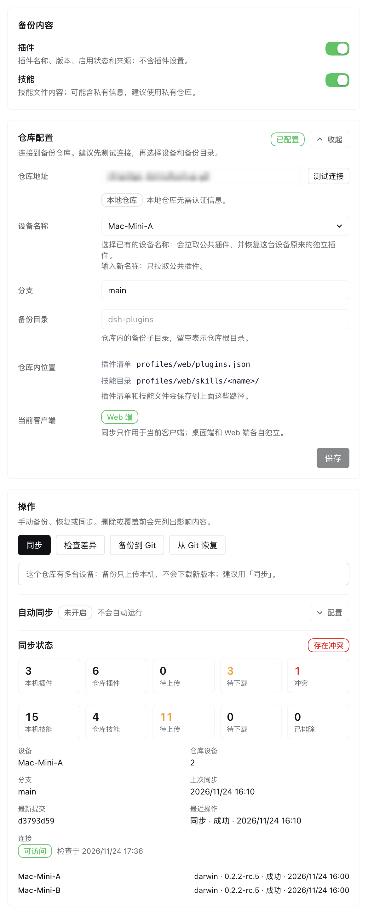
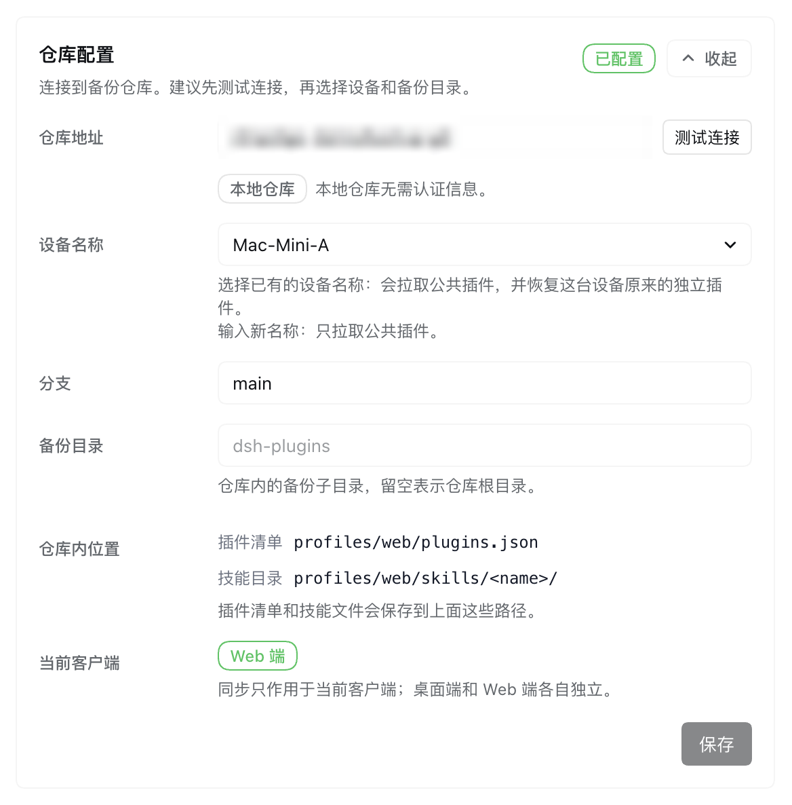
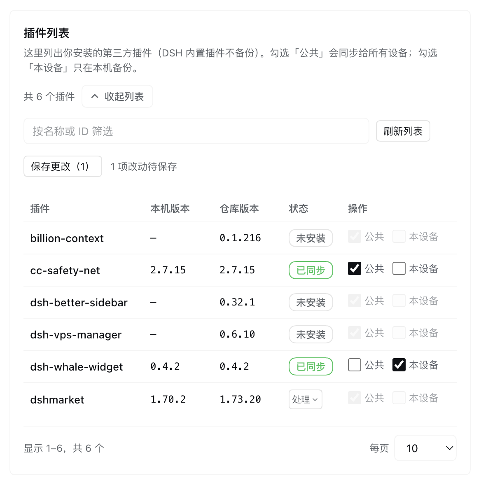
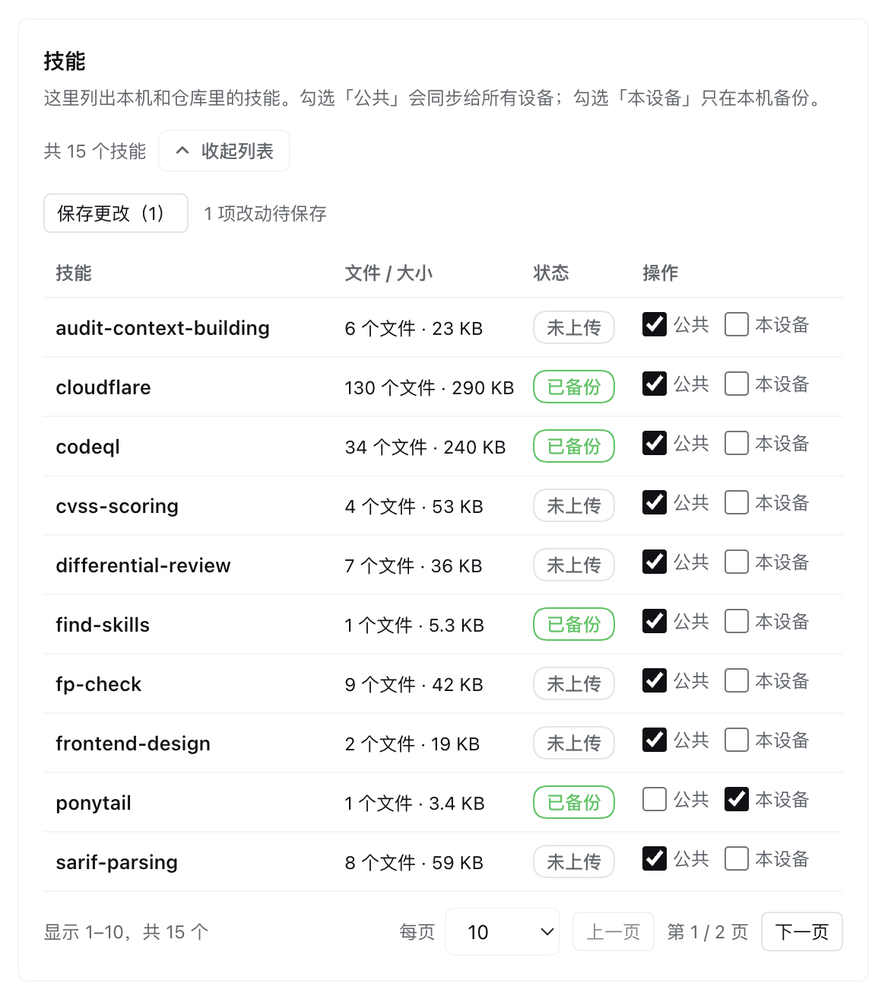
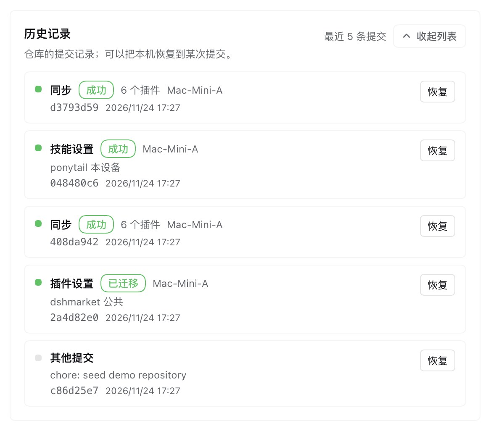

# 插件备份

用你自己的 **Git 仓库**备份、恢复，并在多台设备之间同步 **DeepSeek Harness（DSH）插件清单和已部署技能**。

> 显示名：插件备份 / Plugin Backup · 包名：`dsh-plugins-git-sync` · [English](README_EN.md)

[](https://www.npmjs.com/package/dsh-plugins-git-sync)
[](https://github.com/songni370/dsh-plugins-git-sync/actions/workflows/ci.yml)
[](LICENSE)

换电脑或重装 DSH 时，不用再回忆装过哪些插件、哪个版本、开了哪些技能：把插件清单和技能文件推到一个私有 Git 仓库，另一台设备同步回来即可。插件清单是普通 JSON，技能是真实文件树，可以直接用 Git 查看、对比和回滚。



*设置 →「插件备份」：上方是仓库配置与同步操作，下方是插件、技能两个列表。*

## 核心概念：公共池与本设备

每个插件、每个技能都有两个去向，在列表右侧勾选：

- **公共**（默认）：放进公共池，所有设备都会安装。
- **本设备**：只属于当前设备，其他设备看不到，也不会安装。

勾选后不会立刻上传，点列表上方的「保存更改」才会写入仓库。仓库里的「设备名称」决定这台设备恢复哪些内容：

| 设备名称 | 首次同步会拿到 |
| --- | --- |
| 选择已有设备 | 公共池 + 这台设备原来标记为「本设备」的插件和技能 |
| 输入新名称（或改名） | 只拿公共池，不会继承其他设备的独立插件 |

> 两台机器使用同一个设备名称时，会共用同一份「本设备」清单；建议每台机器用不同的名称。

## 界面

### 仓库配置

先填仓库地址，点「测试连接」确认能访问、并看到仓库里已有的设备；然后再选设备名称、分支和备份目录。



*设备名称可以直接输入，也可以从下拉框选择仓库里已有的设备。*

- **HTTPS**：使用 Git 凭据助手，或填写保存 Token 的**环境变量名**（Token 本身不写进插件配置）。
- **SSH**：使用系统 SSH Agent / `~/.ssh` 密钥，无需额外填写。
- **备份目录**：可选。填写后，插件和技能会存到仓库的子目录里，「仓库内位置」会显示实际路径。

### 插件列表

每行显示本机版本、仓库版本、状态，以及「公共 / 本设备」两个勾选框。有冲突的行会在状态列出现「处理」下拉，单独解决这一个插件。



*「公共」是默认值；改成「本设备」后点「保存更改」才生效。*

### 技能列表

技能列表和插件列表使用同样的「公共 / 本设备」规则。同步会补齐公共池里、本机还缺的技能；标记为「本设备」的技能只备份，不会装到其他设备。



### 冲突处理

两边都改了、或者一边删除另一边还在用时，同步会停下来，并在受影响的行上给出可选项（插件列表截图里 dshmarket 行的「处理」就是入口）；只处理这一行，不需要整次同步一起决定。冲突选项会说明每个选择的后果，默认不会自动删除或复活插件。

### 历史记录

每次备份、同步、恢复、修改设置都会留下提交。历史里直接显示「插件设置 / 同步 / 其他提交」和「成功 / 已迁移 / 无改动」，可以恢复到任意一次提交。



## 备份什么

| 内容 | 是否备份 | 说明 |
| --- | --- | --- |
| 插件清单 | ✅ | 插件名称、版本、启用状态和安装来源 |
| 已部署技能 | ✅ | `~/.dsh/skills` 中已部署的技能文件，保存为真实文件树 |
| 插件配置 | ❌ | 配置里可能含 API Key、Token、密码，不做启发式过滤 |
| Agent 预设 | ❌ | 可能包含 MCP 凭据、环境变量和执行权限 |
| 界面设置 | ❌ | 不属于本插件的备份范围 |
| Token / 私钥 / Cookie | ❌ | 不读取、不写入、不上传 |

同步只覆盖**用户安装的第三方插件**和**已部署技能**。DSH 内置插件、`cordis:*` 加载器条目和本插件自身不会进入备份。

## 功能

- **双向同步**：本机改动上传，仓库改动下载；两边都改时停下来让你选择，不自动合并或覆盖。
- **公共池 + 本设备**：插件和技能各有一个「公共 / 本设备」勾选框，默认公共；勾选后统一点「保存更改」提交，避免每改一次都产生一次 Git 提交。
- **设备身份**：设备名称在仓库里唯一标识一台机器，决定同步时拿公共池还是连带自己的独立插件；换机或重装时填回原名称即可恢复。
- **删除不复活**：只有本机明确删除才写删除记录；其他设备同步到「仓库已删除、本机仍在」时会停下来询问，不会自动把插件重新传回仓库。
- **冲突逐行处理**：冲突行的状态列有「处理」下拉，按原因选择「用本机版本 / 用仓库版本 / 删除仓库记录 / 删除本机副本」，只影响这一个插件。
- **版本策略**：默认跟随最新；降级需要确认；目标版本要求更高的 DSH 时跳过并标记「需要更新 DSH」，不会反复失败。
- **待重启生效**：安装后宿主返回「需要重启」时会标记等待重启，不会被误报为已生效。
- **设备可见性**：状态卡显示仓库里的设备数量和每台设备最近一次同步结果；多设备时点「备份」会提示「只上传、不安装」，建议改用「同步」。
- **备份内容开关**：插件、技能分别开关，默认开启；关掉某项后不再上传或恢复对应内容，但仓库里已有的备份保留。
- **技能状态**：技能列表显示已备份 / 未上传 / 未安装 / 有修改 / 已排除。
- **历史回滚**：选择最近提交恢复；本机安全快照自动保留最近 20 个。
- **自动同步**：默认关闭。打开客户端或插件变更后触发，不按定时器运行；遇到冲突或删除类计划会暂停，等你手动处理。
- **检查差异**：在弹窗中预览将要上传、安装、升级或删除的内容，不直接修改本机。
- **即时按钮反馈**：所有异步按钮点击瞬间显示 spinner 并禁用，保存、刷新、恢复、同步都有立即反馈。
- **问题反馈**：设置页简介行右侧的「问题反馈」按钮会打开本项目的 GitHub issue 页面，并预填插件版本、DSH 版本、系统与 Profile 信息，可直接粘贴截图。
- **Agent 工具**：6 个工具，让 Agent 查看状态、备份、恢复、同步、检查差异和查询历史。

## 安装

### 从 npm 安装（推荐）

```sh
dsh plugin --profile web add dsh-plugins-git-sync@latest
```

或在 DSH 插件管理器 / Agent 的 `plugin_manager.install_bundle` 中安装：

```
dsh-plugins-git-sync
```

更新：

```sh
dsh plugin --profile web update dsh-plugins-git-sync@latest
```

> 本文档对应 `main` 分支的最新能力；npm 上已发布的版本可能稍旧，安装前可先查看版本号。

### 从 GitHub 源码安装（备选）

```sh
git+ssh://git@github.com:songni370/dsh-plugins-git-sync.git
```

HTTPS 形式：`https://github.com/songni370/dsh-plugins-git-sync.git`

仓库已提交构建产物 `lib/`，使用 pnpm 的插件管理器无需额外构建。安装后重启 DSH 或刷新页面。

### 本地开发

```bash
git clone https://github.com/songni370/dsh-plugins-git-sync.git
cd dsh-plugins-git-sync
npm ci
npm run build
```

在 `plugin_manager.install_bundle` 中传入该目录的绝对路径即可。链接目录方式下，改代码后需要重新 `npm run build` 并重启/刷新。

## 快速开始

1. 在 GitHub / GitLab 等建一个**私有空仓库**（建议不要自动生成 README）。
2. 打开 设置 →「插件备份」，填写仓库地址（HTTPS 或 SSH）。
3. 点「测试连接」：确认可以访问；如果仓库里之前备份过，设备下拉框里会列出已有设备。
4. 选择设备名称：老机器/换机恢复选已有名称，全新机器输入新名称。
5. 需要的话填写分支和备份目录，点「保存」。
6. 点「同步」：第一次会拉取公共池，并把本机的新插件、新技能按「公共 / 本设备」上传。
7. 第二台设备：安装本插件 → 填同一个仓库 → 测试连接 → 选已有设备名称（恢复它的独立插件）或新名称（只要公共池）→ 同步。

仓库里每台设备的声明单独保存（`devices/<设备编号>/<profile>.json`），公共池删除意图记录在 `pool/removed.json`；同时保留旧版的 `profiles/<profile>/plugins.json` 镜像，方便旧版本只读查看。从旧版本升级时首次写入会自动迁移，无需手动操作。

每个 DSH Profile 需要分别安装、分别同步；仓库里按 Profile 分开存放，互不覆盖。

## 同步判断

同步时对比「公共池 + 本设备声明」和「本机现状」，再结合上次同步基线判断：

| 情况 | 处理 |
| --- | --- |
| 仓库里有、本机没有 | 安装（新设备首次同步会拉公共池） |
| 本机有、仓库没有（且没有删除记录） | 按当前勾选上传为公共或本设备 |
| 本机有、仓库已删除（其他设备删过） | 冲突：选择「用本机恢复仓库」或「删除本机」；默认不自动复活 |
| 本机没有、仓库还有（本机原来装过） | 冲突：选择「从仓库删除」或「保留仓库」 |
| 只有一边改了版本 / 启停 | 跟随改动的一方 |
| 两边都改且结果不同 | 冲突：选择用本机覆盖仓库、用仓库覆盖本机或先不处理 |

- 勾选「本设备」只改变备份去向，不改变安装范围：其他设备本来就没有这份备份。
- 删除公共池插件会记录删除意图，其他设备同步时先询问再卸载，不会静默删除。
- 改本机前会创建本机快照；失败时尽量回滚启停状态。
- 推送被其他设备抢先时会重新拉取、重算、重试，**不会 force push**。
- 没有需要更改的内容时不会产生空提交。

## 自动同步

默认关闭。开启后由事件触发，**不按定时器运行**：

- **打开客户端**：可配置延迟（默认 15 秒）。
- **插件变更**：安装 / 更新 / 卸载后，防抖约 10 秒触发一次。

自动同步遇到冲突或破坏性计划会暂停并记录日志，等待手动处理，不会弹窗或静默删除。

## Agent 工具

工具名沿用 `dsh_git_plugin_*`，保持对既有提示词的兼容：

| 工具 | 作用 |
| --- | --- |
| `dsh_git_plugin_status` | 查看状态、差异数量和最近错误 |
| `dsh_git_plugin_backup` | 备份到仓库 |
| `dsh_git_plugin_restore` | 从仓库或历史提交恢复 |
| `dsh_git_plugin_sync` | 双向同步 |
| `dsh_git_plugin_diff` | 只读差异预览 |
| `dsh_git_plugin_history` | 查看历史提交与快照 |

破坏性操作需要两阶段确认：先预览，再带 `confirm: true` 执行。

## 安全

- 不收集、不上传 Token、密码、私钥、Cookie；HTTPS 只保存环境变量名。
- 不写机器绝对路径；不读取、不写入、不备份插件配置、Agent 预设和界面设置。
- 技能文件会原样上传，可能包含私有提示词或脚本；建议使用**私有仓库**。
- 恢复技能时只补本机缺失的技能，不覆盖已有技能；本机删除只影响本机，不会跨设备传播。
- 只同步插件版本与启停状态，不负责查最新版本或代替插件市场升级。

## 数据位置

默认在 `$DSH_HOME/dsh-plugins-git-sync/`（配置、状态、日志、工作副本、快照）。

从旧版本升级时，如果新目录不存在而旧目录 `$DSH_HOME/dsh-git-plugin-sync/` 存在，会继续使用旧目录，不会丢配置。卸载插件不会自动删除该目录。

## 开发

```bash
npm ci
npm run typecheck
npm run build
npm test        # 单元 + 集成 + 浏览器半渲染测试
npm pack        # 预览发布内容
```

源码结构：

- `src/`：宿主半（插件扫描、技能读写、Git 操作、同步引擎、HTTP 路由、Agent 工具）
- `client/src/`：设置页与插件详情页的浏览器半
- `tests/`：单元、双设备集成（真实临时 Git 仓库）、jsdom 渲染测试
- `docs/ARCHITECTURE.md` · `docs/SECURITY.md` · `docs/PUBLISHING.md`

## 许可证

[MIT](LICENSE)
