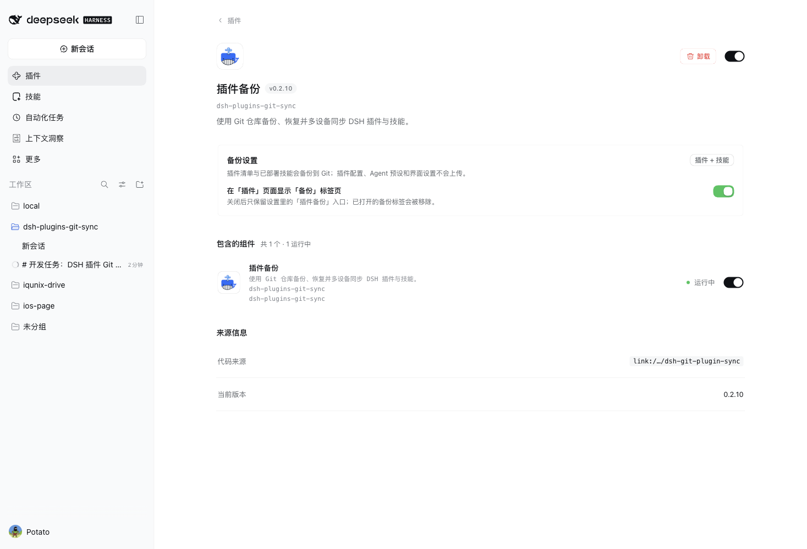
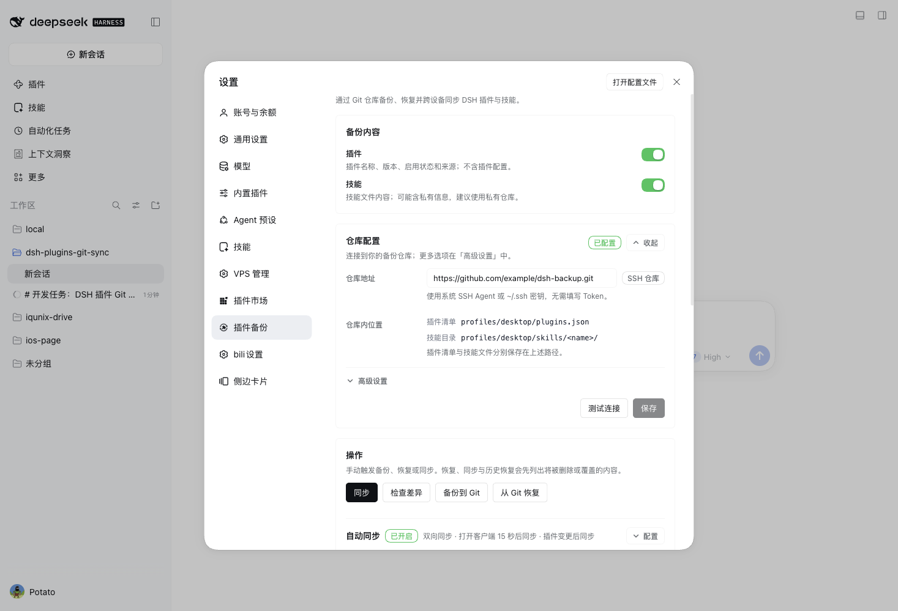

# 插件备份

用你自己的 **Git 仓库**备份、恢复，并在多台设备之间同步 **DeepSeek Harness（DSH）插件清单和已部署技能**。

> 显示名：插件备份 / Plugin Backup · 包名：`dsh-plugins-git-sync` · [English](README_EN.md)

[](https://www.npmjs.com/package/dsh-plugins-git-sync)
[](https://github.com/songni370/dsh-plugins-git-sync/actions/workflows/ci.yml)
[](LICENSE)

换电脑或重装 DSH 时，不用再回忆装过哪些插件、哪个版本、开了哪些技能：把插件清单和技能文件推到一个私有 Git 仓库，另一台设备同步回来即可。插件清单是普通 JSON，技能是真实文件树，可以直接用 Git 查看、对比和回滚。

## 界面

### 插件详情页

在「插件」页打开「插件备份」详情，顶部的「备份设置」卡片可以控制是否在插件页显示「备份」标签页。关闭后只保留设置里的「插件备份」入口。



### 设置页

「备份内容」单独成卡，位于仓库配置上方；插件和技能可分别开关，默认都开启。仓库配置里会显示备份文件在仓库中的位置。



*示例仓库地址已脱敏。*

## 备份什么

| 内容 | 是否备份 | 说明 |
| --- | --- | --- |
| 插件清单 | ✅ | 插件名称、版本、启用状态和安装来源 |
| 已部署技能 | ✅ | `~/.dsh/skills` 中已部署的技能文件，保存为真实文件树 |
| 插件配置 | ❌ | 配置里可能含 API Key、Token、密码，不做启发式过滤 |
| Agent 预设 | ❌ | 可能包含 MCP 凭据、环境变量和执行权限 |
| 界面设置 | ❌ | 不属于本插件的备份范围 |
| Token / 私钥 / Cookie | ❌ | 不读取、不写入、不上传 |

同步只覆盖**用户安装的第三方插件**和**已部署技能**。DSH 内置插件、`cordis:*` 加载器条目和本插件自身不会进入备份。

## 功能

- **双向同步**：本机改动上传，仓库改动下载；两边都改时停下来让你选择，不自动合并或覆盖。
- **冲突提示**：每个选项都说明会发生什么；本机已卸载而仓库还有备份时，明确选择「从仓库删除」或「保留仓库」。
- **备份内容开关**：插件、技能分别开关，默认开启；关掉某项后不再上传或恢复对应内容，但仓库里已有的备份保留。
- **技能状态**：技能列表显示已备份 / 仅本机 / 仅仓库 / 有修改 / 已排除，并支持和插件列表一样的左侧同步勾选。
- **历史回滚**：选择最近提交恢复；本机安全快照自动保留最近 20 个。
- **自动同步**：打开客户端或插件变更后触发，没有定时器；连续失败会在设置页提示。
- **检查差异**：在弹窗中预览将要上传、安装、升级或删除的内容，不直接修改本机。
- **Agent 工具**：6 个工具，让 Agent 查看状态、备份、恢复、同步、检查差异和查询历史。

## 安装

### 从 npm 安装（推荐）

```sh
dsh plugin --profile web add dsh-plugins-git-sync@latest
```

或在 DSH 插件管理器 / Agent 的 `plugin_manager.install_bundle` 中安装：

```
dsh-plugins-git-sync
```

更新：

```sh
dsh plugin --profile web update dsh-plugins-git-sync@latest
```

> 本文档对应 `main` 分支的最新能力；npm 上的已发布版本可能稍旧，安装前可先查看版本号。

### 从 GitHub 源码安装（备选）

```sh
git+ssh://git@github.com:songni370/dsh-plugins-git-sync.git
```

HTTPS 形式：`https://github.com/songni370/dsh-plugins-git-sync.git`

仓库已提交构建产物 `lib/`，使用 pnpm 的插件管理器无需额外构建。安装后重启 DSH 或刷新页面。

### 本地开发

```bash
git clone https://github.com/songni370/dsh-plugins-git-sync.git
cd dsh-plugins-git-sync
npm ci
npm run build
```

在 `plugin_manager.install_bundle` 中传入该目录的绝对路径即可。链接目录方式下，改代码后需要重新 `npm run build` 并重启/刷新。

## 快速开始

1. 在 GitHub / GitLab 等建一个**私有空仓库**（建议不要自动生成 README）。
2. 打开 设置 →「插件备份」，填写仓库地址：
   - **HTTPS**：使用 Git 凭据助手，或填写保存 Token 的**环境变量名**（Token 值本身不写进插件配置）。
   - **SSH**：使用系统 SSH Agent / `~/.ssh` 密钥，无需额外填写。
3. 点「测试连接」→「保存」。
4. 点「同步」，第一次会生成初始备份并推送。
5. 第二台设备：安装本插件 → 填同一个仓库和认证方式 → 保存 → 点「同步」或「从 Git 恢复」。

每个 DSH Profile 需要分别安装、分别同步；仓库里按 `profiles/<profile>/` 分开存放，互不覆盖。

## 同步判断

本机保存一份「上次与仓库一致」的基线（base），每次同步对比 `base / 本机 / 仓库`：

| 情况 | 处理 |
| --- | --- |
| 只有本机变了 | 推送到仓库 |
| 只有仓库变了 | 应用到本机（安装 / 升级 / 降级 / 启停） |
| 两边都没变，或两边改成相同结果 | 跳过 |
| 本机有、仓库没有 | 不算冲突，补回仓库 |
| 本机没有、仓库还有 | 冲突：选择「从仓库删除」或「保留仓库」 |
| 两边都变且结果不同 | 冲突：选择用本机覆盖仓库、用仓库覆盖本机或先不处理 |

- 只有明确选择「从仓库删除」才会删除仓库条目；选择「保留仓库」时其余步骤继续执行。
- 改本机前会创建本机快照；失败时尽量回滚启停状态。
- 推送被其他设备抢先时会重新拉取、重算、重试，**不会 force push**。
- 没有需要更改的内容时不会产生空提交。

## 自动同步

默认关闭。开启后由事件触发，**不按定时器运行**：

- **打开客户端**：可配置延迟（默认 15 秒）。
- **插件变更**：安装 / 更新 / 卸载后，防抖约 10 秒触发一次。

自动同步遇到冲突或破坏性计划会暂停并记录日志，等待手动处理，不会弹窗或静默删除。

## Agent 工具

工具名沿用 `dsh_git_plugin_*`，保持对既有提示词的兼容：

| 工具 | 作用 |
| --- | --- |
| `dsh_git_plugin_status` | 查看状态、差异数量和最近错误 |
| `dsh_git_plugin_backup` | 备份到仓库 |
| `dsh_git_plugin_restore` | 从仓库或历史提交恢复 |
| `dsh_git_plugin_sync` | 双向同步 |
| `dsh_git_plugin_diff` | 只读差异预览 |
| `dsh_git_plugin_history` | 查看历史提交与快照 |

破坏性操作需要两阶段确认：先预览，再带 `confirm: true` 执行。

## 安全

- 不收集、不上传 Token、密码、私钥、Cookie；HTTPS 只保存环境变量名。
- 不写机器绝对路径；不读取、不写入、不备份插件配置、Agent 预设和界面设置。
- 技能文件会原样上传，可能包含私有提示词或脚本；建议使用**私有仓库**。
- 恢复技能时只补本机缺失的技能，不覆盖已有技能；删除不会跨设备传播。
- 只同步插件版本与启停状态，不负责查最新版本或代替插件市场升级。

## 数据位置

默认在 `$DSH_HOME/dsh-plugins-git-sync/`（配置、状态、日志、工作副本、快照）。

从旧版本升级时，如果新目录不存在而旧目录 `$DSH_HOME/dsh-git-plugin-sync/` 存在，会继续使用旧目录，不会丢配置。卸载插件不会自动删除该目录。

## 开发

```bash
npm ci
npm run typecheck
npm run build
npm test        # 单元 + 集成 + 浏览器半渲染测试
npm pack        # 预览发布内容
```

源码结构：

- `src/`：宿主半（插件扫描、技能读写、Git 操作、同步引擎、HTTP 路由、Agent 工具）
- `client/src/`：设置页与插件详情页的浏览器半
- `tests/`：单元、双设备集成（真实临时 Git 仓库）、jsdom 渲染测试
- `docs/ARCHITECTURE.md` · `docs/SECURITY.md` · `docs/PUBLISHING.md`

## 许可证

[MIT](LICENSE)
