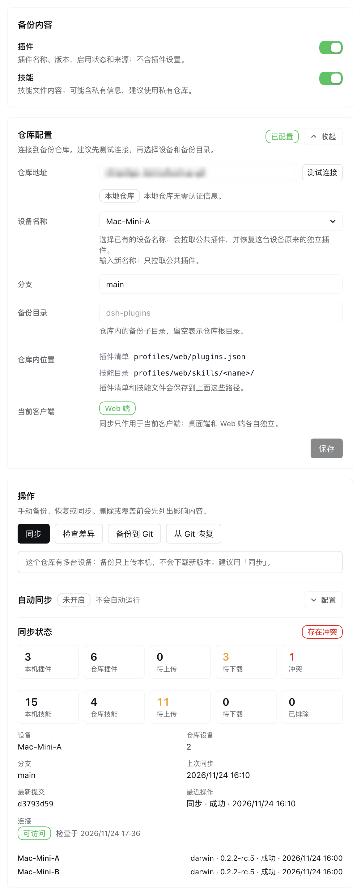
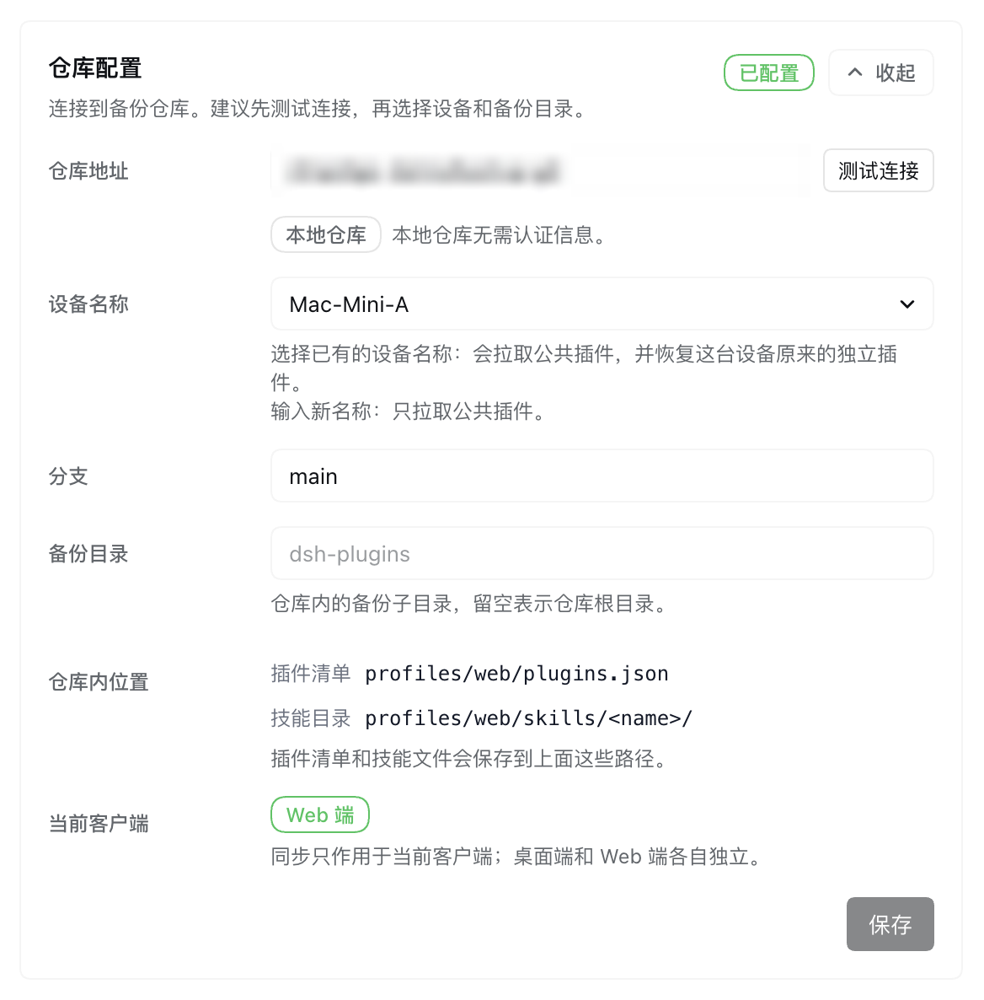
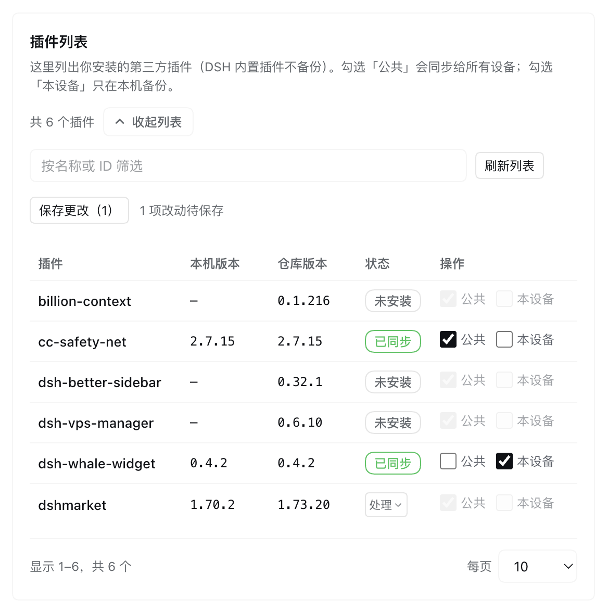
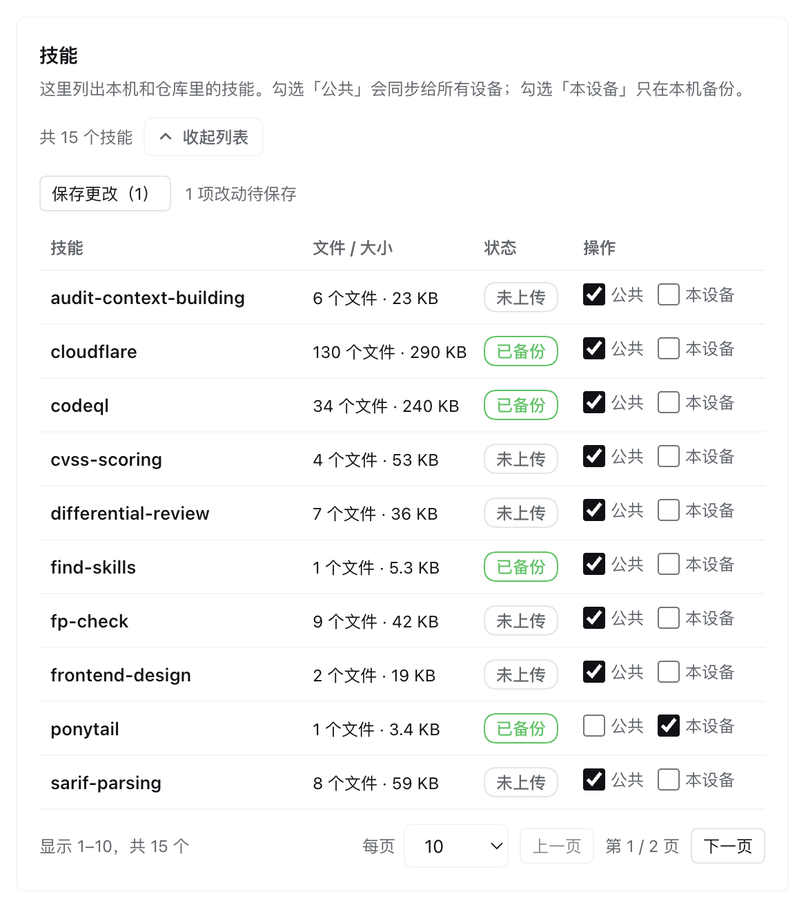
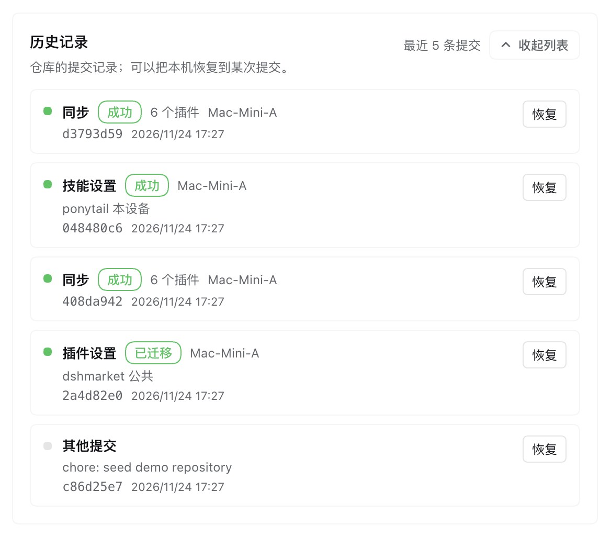

# Plugin Backup

Back up, restore, and synchronize **DeepSeek Harness (DSH) plugin lists and deployed skills** across devices through your own **private Git repository**.

> Display name: 插件备份 / Plugin Backup · Package: `dsh-plugins-git-sync` · [中文](README.md)

[](https://www.npmjs.com/package/dsh-plugins-git-sync)
[](https://github.com/songni370/dsh-plugins-git-sync/actions/workflows/ci.yml)
[](LICENSE)

Moving to a new machine or reinstalling DSH no longer means rebuilding your plugin list from memory: push the inventory and the deployed skill files to a private Git repository and pull them down on another device. The inventory is plain JSON and skills are stored as real files, so everything can be viewed, diffed and rolled back with ordinary Git tools.



*Settings → "Plugin Backup": repository configuration and sync controls on top, the plugin and skill lists below. The screenshots show the Chinese UI; the plugin follows your DSH language setting.*

## Core concepts: public pool and this device

Every plugin and every skill has one of two destinations, chosen with the checkboxes on the right of the list:

- **Public** (default): goes into the public pool and is installed on every device.
- **This device**: belongs to the current device only; other devices neither see nor install it.

Changes are not uploaded immediately — click **Save changes** above the list to write them to the repository. The **device name** stored in the repository decides what a device restores:

| Device name | What the first sync pulls |
| --- | --- |
| Pick an existing device | The public pool plus the plugins and skills that device had marked as "this device" |
| Enter a new name (or rename) | Only the public pool; no other device's private entries are inherited |

> Two machines sharing the same device name also share the same "this device" list; use a distinct name per machine.

## UI

### Repository configuration

Enter the repository URL first and click **Test connection** to confirm access and load the devices already present in the repository; then pick the device name, branch and backup directory.



*The device name can be typed or picked from the devices already present in the repository.*

- **HTTPS**: use the Git credential helper, or provide the **environment variable name** that holds the token (the token itself is never stored in the plugin config).
- **SSH**: uses the system SSH agent / `~/.ssh` keys; nothing else to fill in.
- **Backup directory**: optional. When set, plugins and skills are stored in a subdirectory of the repository and "Location in repository" shows the actual paths.

### Plugin list

Each row shows the local version, repository version, status, and the two **Public / This device** checkboxes. Conflicting rows expose a **Resolve** dropdown in the status column so that one plugin can be handled on its own.



*"Public" is the default; switching a row to "This device" takes effect after clicking "Save changes".*

### Skill list

Skills follow the same Public / This device rule. Sync fills in skills that are in the public pool but missing here; skills marked "this device" are only backed up for this machine and never installed elsewhere.



### Conflict handling

When both sides changed, or one side deleted a plugin the other still uses, sync stops and offers the valid choices on the affected row (the "Resolve" control shown on the dshmarket row in the plugin-list screenshot); each row can be handled without deciding the whole sync at once. Every choice explains its consequence, and nothing is deleted or resurrected automatically by default.

### History

Every backup, sync, restore and settings change leaves a commit. History shows "Plugin settings / Sync / Other commit" and "Success / Migrated / No changes" directly, and any commit can be restored.



## What gets backed up

| Content | Backed up | Notes |
| --- | --- | --- |
| Plugin inventory | ✅ | Package name, version, enabled state and install source |
| Deployed skills | ✅ | Files of deployed skills under `~/.dsh/skills`, stored as a real file tree |
| Plugin configuration | ❌ | May contain API keys, tokens or passwords; no heuristic filtering is attempted |
| Agent presets | ❌ | May contain MCP credentials, environment variables and execution permissions |
| UI settings | ❌ | Outside this plugin's backup scope |
| Tokens / private keys / cookies | ❌ | Never read, written or uploaded |

Sync only covers **user-installed third-party plugins** and **deployed skills**. DSH built-ins, `cordis:*` loader entries and this plugin itself never enter the backup.

## Features

- **Two-way sync**: local changes are uploaded and repository changes downloaded; when both sides changed it stops and asks, never merging or overwriting silently.
- **Public pool + this device**: plugins and skills each have a Public / This device checkbox, public by default; edits are staged and committed together with one "Save changes", so changing ten rows creates one Git commit.
- **Device identity**: the device name uniquely identifies a machine in the repository and decides whether a sync pulls only the public pool or also that device's private plugins. Keep the old name when moving machines to restore them.
- **Deletions do not resurrect**: only an explicit local uninstall records a deletion; a device that still has the plugin stops and asks when it sees "deleted in the repository, still present here" instead of silently re-uploading it.
- **Per-row conflict resolution**: the status column of a conflicting row offers "use this device's version / use the repository version / delete the repository record / remove the local copy", affecting only that plugin.
- **Version policy**: tracks the newest version by default; downgrades require confirmation; versions that need a newer DSH are skipped and marked "DSH update required" instead of failing over and over.
- **Pending activation**: installs that the host reports as `restart-required` are marked as pending, not reported as active.
- **Device visibility**: the status card lists how many devices share the repository and each device's last sync result; with multiple devices, "Back up to Git" warns that it only uploads and suggests Sync instead.
- **Backup scope switches**: plugins and skills can be enabled independently, both on by default; turning one off stops uploading and restoring that content while existing repository backups remain.
- **Skill status**: the skill list distinguishes backed up / not uploaded / not installed / modified / excluded.
- **History rollback**: restore to a recent commit; the latest 20 local safety snapshots are kept automatically.
- **Automatic sync**: off by default. Triggered on client startup and plugin changes, with no interval timer; conflicts and destructive plans pause it until handled.
- **Check differences**: preview what would be uploaded, installed, upgraded or deleted without touching the machine.
- **Instant button feedback**: every async button shows a spinner and disables itself immediately — save, refresh, restore and sync all give instant feedback.
- **Issue feedback**: the "Feedback" button on the intro row opens this project's GitHub issue form, prefilled with the plugin version, DSH version, OS and profile facts; paste a screenshot there.
- **Agent tools**: six tools for status, backup, restore, sync, diff and history.

## Install

### From npm (recommended)

```sh
dsh plugin --profile web add dsh-plugins-git-sync@latest
```

Or through the DSH plugin manager / an agent's `plugin_manager.install_bundle`:

```
dsh-plugins-git-sync
```

Update:

```sh
dsh plugin --profile web update dsh-plugins-git-sync@latest
```

> This document reflects the latest capabilities on `main`; the published npm version may lag slightly behind. Check the version number before installing.

### From the GitHub source (alternative)

```
git+ssh://git@github.com:songni370/dsh-plugins-git-sync.git
```

HTTPS: `https://github.com/songni370/dsh-plugins-git-sync.git`

The built `lib/` is committed, so a pnpm-based plugin manager needs no build step. Restart DSH or refresh the page after installing.

### Local development

```bash
git clone https://github.com/songni370/dsh-plugins-git-sync.git
cd dsh-plugins-git-sync
npm ci
npm run build
```

Pass the absolute path of that directory to `plugin_manager.install_bundle`. With a linked directory, rebuild and restart/refresh after changing code.

## Quick start

1. Create a **private empty repository** on GitHub / GitLab (do not initialise it with a README).
2. Open Settings → "Plugin Backup" and enter the repository URL (HTTPS or SSH).
3. Click **Test connection**: confirm the repository is reachable; if it already has backups, the device dropdown lists the existing devices.
4. Choose a device name: reuse the existing name when restoring or moving a machine, or enter a new name for a fresh machine.
5. Optionally set the branch and backup directory, then click **Save**.
6. Click **Sync**: the first run pulls the public pool and uploads this machine's new plugins and skills according to their Public / This device setting.
7. For a second device: install the plugin → enter the same repository → Test connection → pick the existing device name (restores its private plugins) or a new name (public pool only) → Sync.

The repository stores each device's declaration separately (`devices/<deviceId>/<profile>.json`) and records public-pool deletion intents in `pool/removed.json`; the legacy `profiles/<profile>/plugins.json` mirror is still written so older versions can read the repository. Upgrading from an older version migrates automatically on the first write, with no manual step.

Each DSH profile installs and syncs separately; the repository keeps profiles in separate directories, so they never overwrite each other.

## How sync decides

Sync compares "public pool + this device's declaration" with the local state, using the last agreed baseline:

| Situation | Action |
| --- | --- |
| In the repository, missing here | Install (a new device pulls the public pool on its first sync) |
| Present here, missing in the repository (no deletion record) | Upload as Public or This device according to the checkbox |
| Present here, deleted in the repository by another device | Conflict: restore the repository copy or remove it locally; never resurrected automatically |
| Missing here, still in the repository (this device had it) | Conflict: delete from the repository or keep it there |
| Only one side changed version / enabled state | Follow the changed side |
| Both sides changed to different results | Conflict: overwrite the repository with this device, overwrite this device with the repository, or leave it for now |

- Checking "This device" only changes where a plugin is backed up; it does not change installation scope — other devices never had that backup.
- Deleting a public-pool plugin records a deletion intent; other devices ask before uninstalling instead of deleting silently.
- A local snapshot is taken before changing this device; enabled state is rolled back where possible on failure.
- A rejected push is re-fetched, re-planned and retried; **never force-pushed**.
- Nothing to change means no empty commit.

## Automatic sync

Off by default. Event-driven, **no interval timer**:

- **Client startup**: configurable delay (15 seconds by default).
- **Plugin changes**: install / update / uninstall triggers a debounced run (~10 seconds).

Automatic runs pause on conflicts or destructive plans and log the reason; they never prompt or delete silently.

## Agent tools

Tool names remain `dsh_git_plugin_*` for compatibility with existing prompts:

| Tool | Purpose |
| --- | --- |
| `dsh_git_plugin_status` | Status, pending counts and last error |
| `dsh_git_plugin_backup` | Back up to the repository |
| `dsh_git_plugin_restore` | Restore from the repository or a commit |
| `dsh_git_plugin_sync` | Two-way sync |
| `dsh_git_plugin_diff` | Read-only difference preview |
| `dsh_git_plugin_history` | Commit history and snapshots |

Destructive operations use two-phase confirmation: preview first, then run with `confirm: true`.

## Security

- Never collects or uploads tokens, passwords, private keys or cookies; HTTPS stores only the environment variable name.
- No absolute machine paths are written to the repository; plugin configuration, Agent presets and UI settings are never read, written or backed up.
- Skill files are uploaded verbatim and may contain private prompts or scripts; use a **private repository**.
- Restoring skills only adds missing ones and never overwrites existing ones; a local uninstall affects only this machine and is not propagated.
- It syncs plugin versions and enabled state; it does not look up newer versions or replace the plugin market.

## Data location

Defaults to `$DSH_HOME/dsh-plugins-git-sync/` (config, state, log, work tree, snapshots).

When upgrading from an older version, the plugin keeps using `$DSH_HOME/dsh-git-plugin-sync/` if that directory exists and the new one does not, so configuration is preserved. Uninstalling the plugin does not delete this directory.

## Development

```bash
npm ci
npm run typecheck
npm run build
npm test        # unit + integration + browser half-render tests
npm pack        # inspect the published content
```

Layout:

- `src/` — host half (plugin scanning, skills, Git, sync engine, HTTP routes, Agent tools)
- `client/src/` — browser half for the settings page and the plugin detail page
- `tests/` — unit tests, two-device integration against real temporary Git repositories, jsdom render tests
- `docs/ARCHITECTURE.md` · `docs/SECURITY.md` · `docs/PUBLISHING.md`

## License

[MIT](LICENSE)
