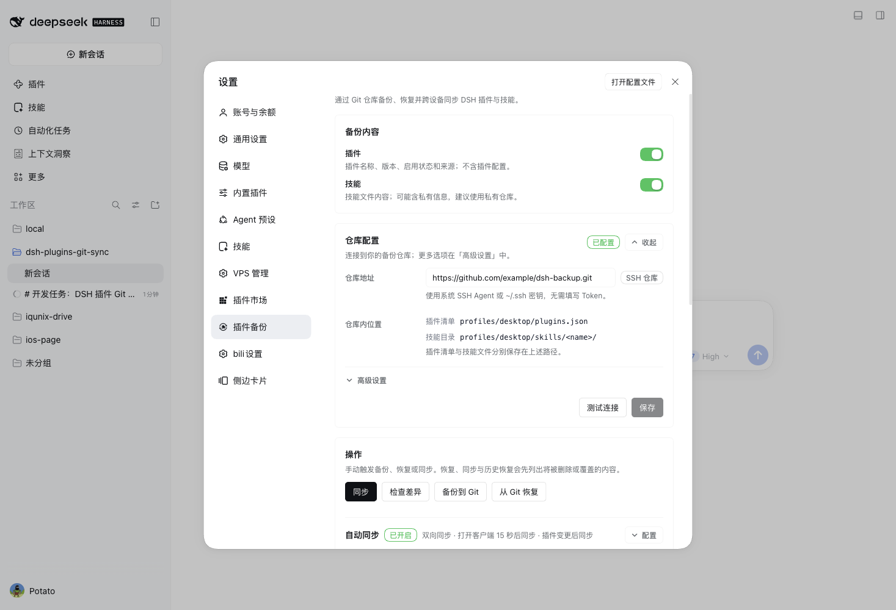
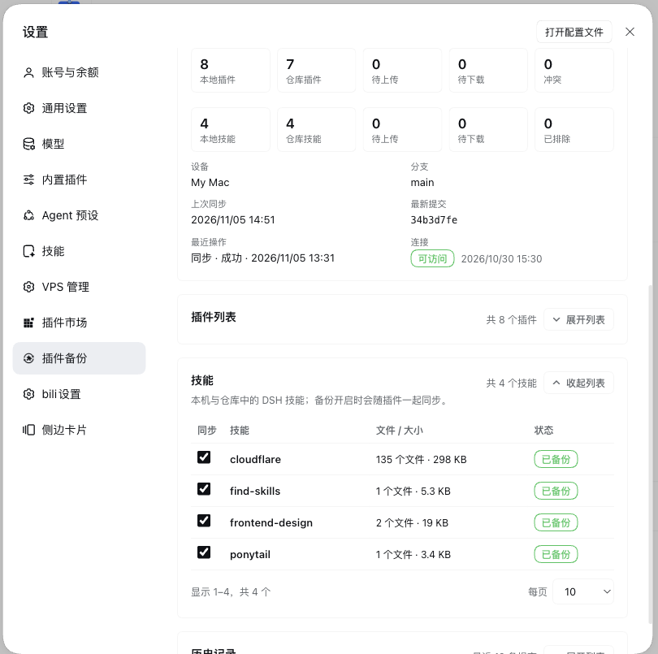

# Plugin Backup

> Display name: 插件备份 / Plugin Backup · Package / repository: `dsh-plugins-git-sync` · [中文](README.md)

Back up, restore, and synchronize **DeepSeek Harness (DSH) plugin lists and deployed skills** across devices through your own **Git repository**.

[](https://www.npmjs.com/package/dsh-plugins-git-sync)
[](https://github.com/songni370/dsh-plugins-git-sync/actions/workflows/ci.yml)
[](LICENSE)



*Initial state: enter a Git repository URL to start; the device name is only an example.*

Reinstalling DSH or moving to another machine no longer means rebuilding a plugin list from memory: push the inventory and deployed skills to a private repository and pull them down elsewhere. The plugin inventory is plain JSON and skills are stored as real files, all readable and diffable with ordinary Git tools.

## What it does

- **Backup / restore**: push user-installed plugins (version, enabled state) to Git; install them back on another device.
- **Skill backup**: capture deployed files under `~/.dsh/skills` (following symlinks to their content) as a real file tree at `profiles/<profile>/skills/<name>/...`; restore only missing skills and never overwrite an existing one.
- **Two-way sync**: upload local changes, download repository changes; when both sides changed it stops and asks.
- **Conflict handling**: overwrite repository with this device / overwrite this device with repository / leave for now; each button explains what it will do. When this device removed a plugin that the repository still backs up, choose Delete from repository or Keep repository.
- **History rollback**: restore this device to any previous commit; local safety snapshots keep the latest 20 automatically.
- **Automatic sync**: on client startup and plugin install/update/remove; **no interval timer**; repeated failures are shown on the settings page.
- **Agent tools**: six tools for status, backup, restore, sync, diff and history.
- **Preview before upload**: `Check differences` lists the plugins that will be uploaded, installed, upgraded or deleted, so you can confirm first.
- **Safety**: no tokens, passwords or private keys are read or uploaded; **plugin configuration, Agent presets and UI settings are never backed up**; no force pushes; a snapshot precedes local changes.

Only **user-installed third-party plugins** and **deployed DSH skills** participate. DSH built-ins, loader internals (`cordis:*`) and this plugin itself are never backed up.

## UI

Settings → "**Plugin Backup**". The Plugins page can also show a "Backup" tab with the same content.
The plugin's own detail page also has a compact **Backup settings** card showing the scope and controlling whether that Backup tab appears.



*Sync status, count tiles and the automatic-sync switch on one page; nothing runs in the background until a repository is configured.*

- **Backup contents**: its own card above the repository card; plugin and skill switches are independent and both on by default. Turning one off stops uploading and restoring that content while existing repository backups remain.
- **Repository card**: detects HTTPS / SSH / local paths, shows only the matching auth fields, and displays where plugin and skill files live in the repository; collapsed once configured.
- **Operations**: `Sync`, `Check differences`, `Back up to Git` and `Restore from Git` are four direct buttons; nothing is hidden in a menu.
  - `Sync` runs directly when there are no conflicts or delete/overwrite steps; only those open a confirmation preview.
- **Sync status**: badge, count tiles and metadata, in the same card as the operations.
- **Automatic sync**: collapsed by default, shows on/off and trigger summary; expand to edit startup delay and triggers.
- **Plugin list**: collapsed by default; filter, pagination (10 per page by default, 5/10/20/50/100) and per-plugin sync switch; deployed skills are listed below with file count, size and backup status (backed up / this device only / repository only / modified), collapsed and paginated like the plugin list.
- **History**: collapsed by default and limited to the latest 10 commits; expand to restore a commit; long subjects are ellipsised.

## Install

### From npm (recommended)

Published on npm:

```sh
dsh plugin --profile web add dsh-plugins-git-sync@latest
```

Or through the DSH plugin manager / `plugin_manager.install_bundle`:

```
dsh-plugins-git-sync
```

Update:

```sh
dsh plugin --profile web update dsh-plugins-git-sync@latest
```

### From the GitHub source (alternative)

```
git+ssh://git@github.com:songni370/dsh-plugins-git-sync.git
```

HTTPS: `https://github.com/songni370/dsh-plugins-git-sync.git`

The built `lib/` is committed, so a pnpm-based plugin manager needs no build step. Restart DSH or refresh the page after installing.

### Local development

```bash
git clone https://github.com/songni370/dsh-plugins-git-sync.git
cd dsh-plugins-git-sync
npm ci
npm run build          # lib/ (host + browser half)
```

Install with the local directory path via `plugin_manager.install_bundle`; rebuild and restart after changes.

## Quick start

1. Create a **private empty repository**.
2. Settings → "Plugin Backup", enter the URL:
   - **HTTPS**: use the Git credential helper, or "HTTPS token" and provide the *environment variable name* holding the token.
   - **SSH**: use the SSH agent / keys in `~/.ssh`; nothing else to fill in.
3. "Test connection" → save.
4. Click "Sync" to create the first backup.
5. On a second device: install the plugin, configure the same repository, save, then "Sync" (or "Restore from Git").

Each DSH profile installs and syncs separately; the repository separates them under `profiles/<profile>/`.

## How sync decides

The device keeps a **baseline** of the last agreed state and compares `base / local / remote`:

| Situation | Action |
| --- | --- |
| Only local changed | Push to repository |
| Only remote changed | Apply locally (install/upgrade/downgrade/enable/disable) |
| Neither changed | Skip |
| Both changed identically | Skip |
| Present here, missing in the repository | Not a conflict; back it up into the repository |
| Missing here, still in the repository | Conflict: delete from repository or keep repository |
| Both changed differently | Conflict; wait for your choice |

- Configs are merged key by key: changes to different keys on two devices are kept automatically. You are only asked when the same key changed to different values, or when the version/enabled state also conflicts.
- A repository entry is only deleted after you explicitly choose “Delete from repository”; “Keep repository” keeps it and lets the rest of the sync run.
- When the repository is missing a plugin this device has, nothing is removed here; it is backed up again.
- Deleting repository entries is destructive and only runs after confirmation.
- A local snapshot is taken before changing this device; enabled state is rolled back on failure when possible.
- A rejected push is re-fetched, re-planned and retried; **never force-pushed**.
- No empty commits are created when nothing changed.

## Automatic sync

Off by default. Event-driven, with **no interval timer**:

- **Client startup**: configurable delay (15 seconds by default; below 5 seconds warns about racing DSH's own plugin installation).
- **Plugin changes**: install/update/remove triggers a debounced run (~10 seconds).

Automatic runs pause on conflicts or destructive plans and log the reason; no prompts and no silent deletions.

## Agent tools

Tool names remain `dsh_git_plugin_*` for compatibility with existing prompts:

| Tool | Purpose |
| --- | --- |
| `dsh_git_plugin_status` | Status, pending counts, last error |
| `dsh_git_plugin_backup` | Backup to the repository |
| `dsh_git_plugin_restore` | Restore from the repository or a commit |
| `dsh_git_plugin_sync` | Two-way sync |
| `dsh_git_plugin_diff` | Read-only difference preview |
| `dsh_git_plugin_history` | Commit history and snapshots |

Destructive operations use two-phase confirmation: preview first, then `confirm: true`.

## Safety and limits

- Never collects or uploads tokens, passwords, private keys or cookies; HTTPS stores only the env-var name.
- No absolute machine paths in backups; plugin configuration, Agent presets and UI settings are never read, written or backed up.
- Skill files are uploaded verbatim and may contain private prompts or scripts; use a private repository. Restore only adds missing skills and never overwrites an existing one.
- A plugin present here but missing in the repository is backed up again, never deleted; a plugin missing here but present in the repository needs an explicit delete-or-skip choice.
- Syncs the active profile only; other profiles install and sync separately.
- Local-dev plugins can be recorded but cannot be installed on another device.
- It synchronizes plugin versions and enabled state; it does not check for newer versions or upgrade plugins for you.

## Data location

`$DSH_HOME/dsh-plugins-git-sync/` (config, state, log, work tree, snapshots).

After upgrading from the old name, the plugin keeps using `$DSH_HOME/dsh-git-plugin-sync/` if that exists and the new directory does not, so configuration is preserved. Uninstalling does not delete this directory.

## Development

```bash
npm ci
npm run typecheck
npm run build
npm test        # unit + integration + jsdom render tests
npm pack
```

Layout:

- `src/` — host half (scanner, skills, Git, sync engine, HTTP routes, agent tools)
- `client/src/` — settings-page browser half
- `tests/` — unit, two-device integration against real temporary Git repos, jsdom rendering
- `docs/ARCHITECTURE.md` · `docs/SECURITY.md` · `docs/PUBLISHING.md`

## License

[MIT](LICENSE)
